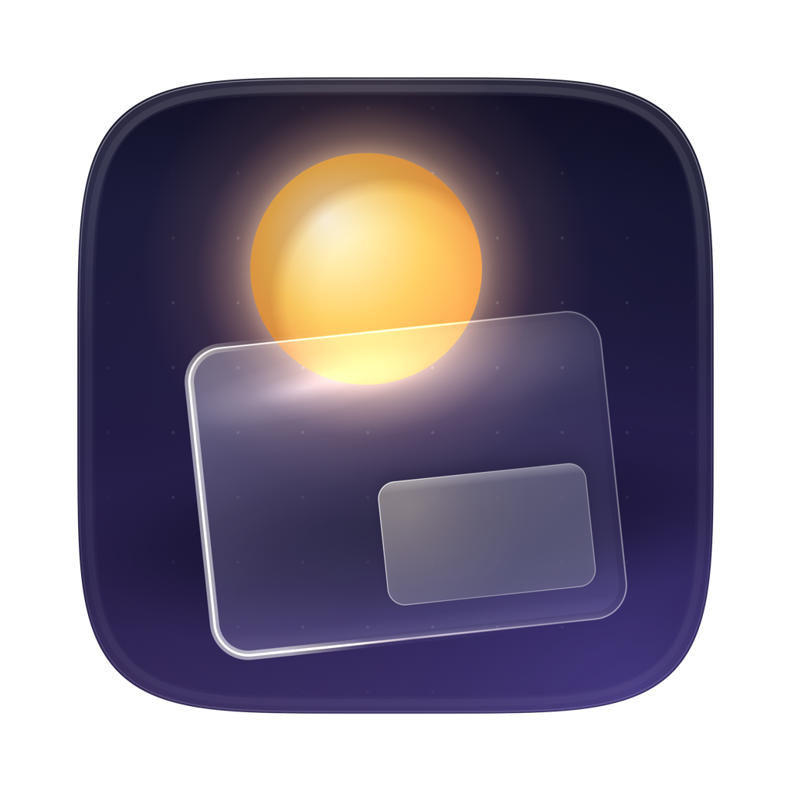
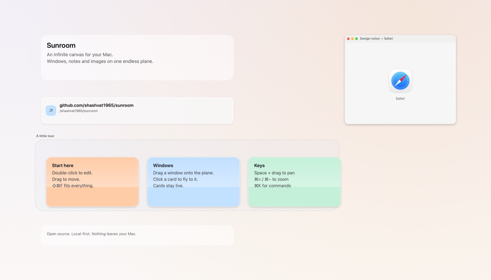
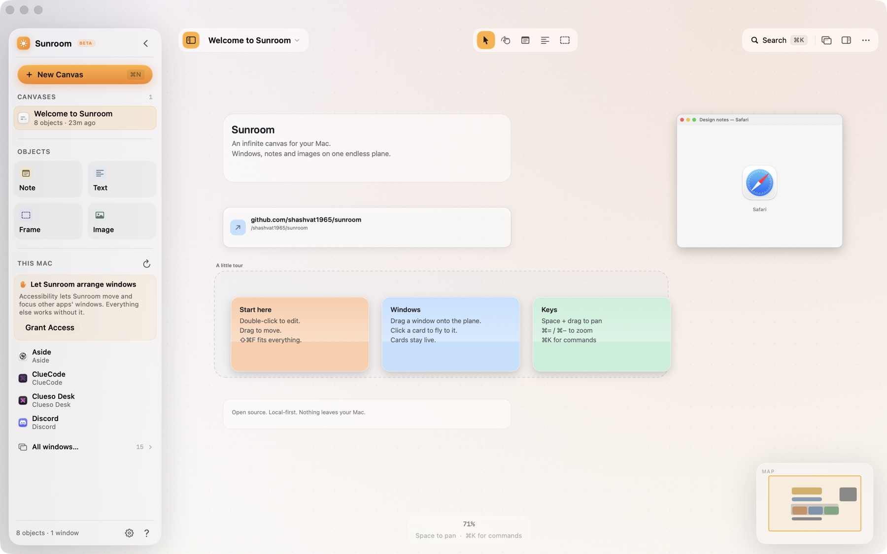
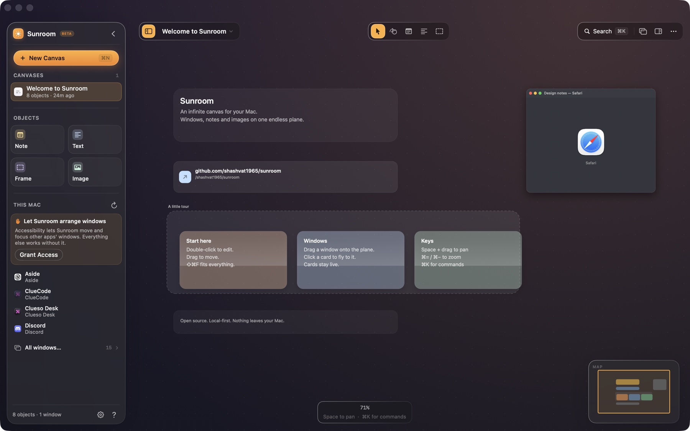
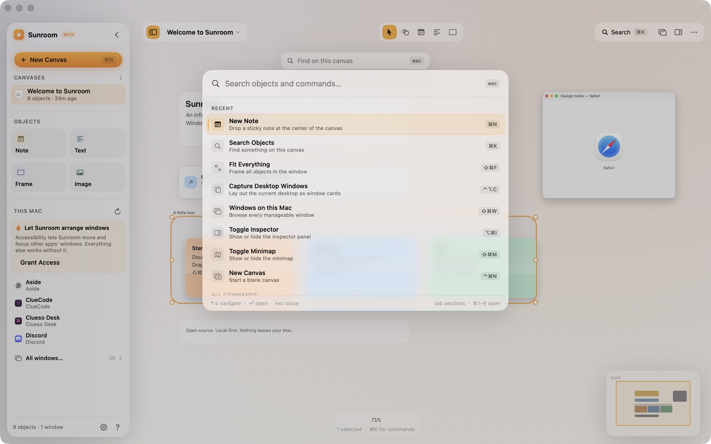
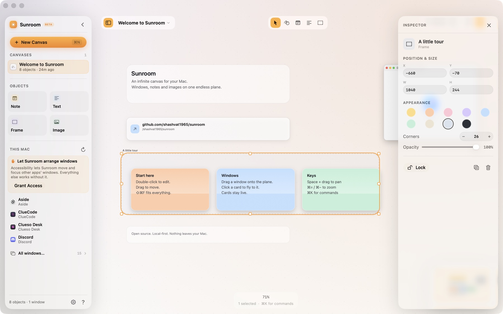
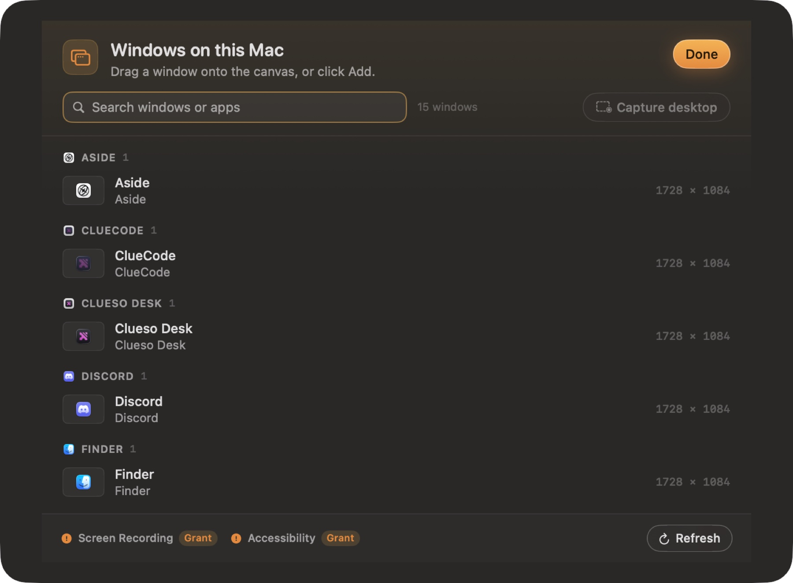
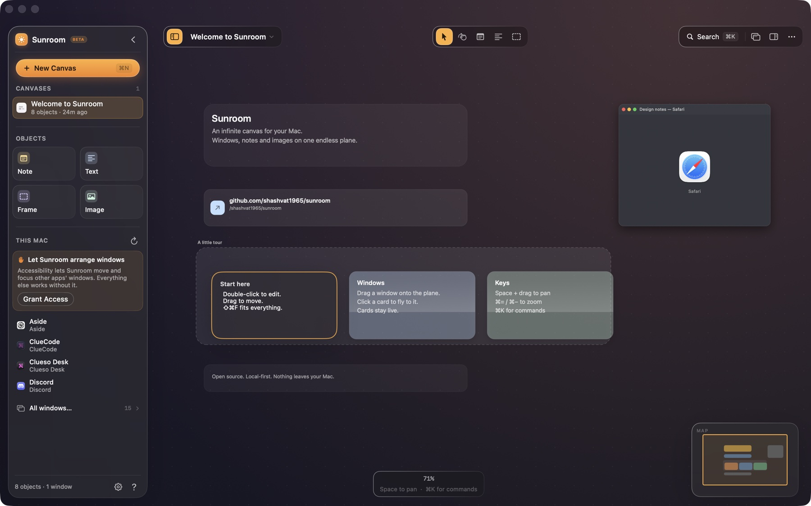
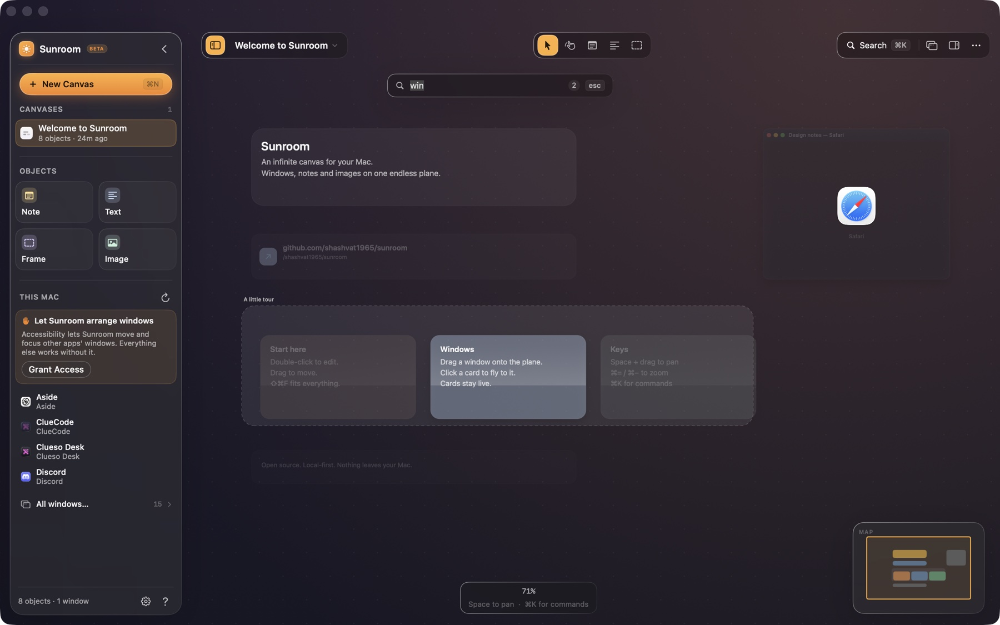

<p align="center">
  
</p>

<h1 align="center">Sunroom</h1>

<p align="center"><strong>An infinite canvas for the windows on your Mac.</strong></p>

<p align="center">
  <a href="#requirements"></a>
  <a href="https://swift.org"></a>
  <a href="LICENSE"></a>
  <a href="https://github.com/shashvat1965/sunroom/actions/workflows/ci.yml"></a>
</p>



> **Project status:** 0.1, usable daily. The canvas engine, window capture, Accessibility-based window arrangement,
> persistence, snapping, layouts, undo and search are implemented, with a headless Core test target that CI runs.
> Everything is local; there is no account, no sync service and no network code in the app.

## Why

Your Mac's window manager is a filing cabinet. Every window belongs in exactly one desktop, desktops are ordered
left to right, and switching spaces feels like opening a drawer. But thinking rarely happens in one drawer. You have
a browser open next to a design file, a terminal behind both, and a note with the three things you keep forgetting.
The work is the relationship between those windows, not the windows themselves.

Sunroom makes the workspace a plane instead of a cabinet. Windows, notes, images and links sit wherever you put them
on one endless surface. Zoom out and the whole project is a landscape; zoom in and a single card is readable. Nothing
is hidden behind a desktop you have to remember to visit. Panning is free, so a thought can sit next to the thing that
caused it.

The two ideas borrowed from the best canvas and tiling tools are simple: the canvas is the source of truth, and the
keyboard is a first-class input. Sunroom is an independent implementation — not a fork of anything — built on public
macOS APIs.

## Features

### Canvas

- **One endless plane.** Canvas coordinates are unbounded and independent of the display. Pan and zoom all you want;
  the nodes never move.
- **2%–1200% zoom** with anchor-preserving pinch and ⌘-scroll, log-space camera animation, and pixel-aligned text at
  rest.
- **Level of detail that respects your GPU.** Full fidelity when you are close, titles when you are not, coloured
  silhouettes when you are looking at the shape of a month's work.
- **Five backgrounds** — Aurora, Dawn, Graphite, Midnight and Paper — with dots, lines or no grid, and a minimap that
  always knows where you are.
- **Frames** for grouping without ownership. Drag a frame over a pile and the contents are adopted; ungroup and
  everything stays exactly where it was.

### Windows

- **Live window cards.** Any window can become a card on the plane, captured with ScreenCaptureKit at a capped
  resolution and refreshed at a human cadence — not a video stream burning your battery.
- **Place a window** from the window library, or capture the whole desktop at once and get a card for every window,
  laid out exactly where it sits on your screens. System UI, menu bar extras and Sunroom's own windows are excluded.
- **Move the real thing.** Drag a card to arrange your thinking, then push the layout back to the actual windows with
  a single command. Positions and sizes are applied through the Accessibility API in batches, not one attribute at a
  time.
- **Focus, reveal, refresh.** Jump from a card to its real window, or refresh a stale thumbnail without leaving the
  canvas.
- **Capture is opt-in and pausable.** Turn previews off in Settings and cards keep their last frame. Useful on
  battery, on a call, or when a window should not be mirrored.

A honest note on the interaction model: macOS gives no public way to composite another app's window into your own
view, so Sunroom is not a compositor-level plane like phantomat on Hyprland. The canvas is the planner; the desktop is
the output. You arrange cards, then **Apply Layout to Desktop** moves the real windows into those positions with an
eased Accessibility tween. Nothing is faked, and no private window-server tricks are used.

### Organizing

- **Snapping that behaves.** Edges and centres are solved independently, so a corner can align on one axis while
  centring on the other. Guides show why something moved. Grid snapping is opt-in.
- **Align and distribute** a selection, or reflow it as a grid, rows, columns or a radial arrangement.
- **Duplicate, lock, collapse, reorder.** Frames paint behind their contents; everything else keeps a predictable
  z-order.
- **Fuzzy search** across note titles, body text, link hosts and window titles, with the same matcher used by the
  command palette.

### Keyboard

- **⌘K command palette.** Commands, canvases and nodes in one list. Fuzzy matching, arrow-key navigation, and numbers
  for the actions you use most.
- **Type to find.** Start typing on the canvas and a jump bar opens without a modifier. Return travels to the match.
- **Fit all, fit selection, actual size** on one keystroke each.
- **A complete, documented shortcut set** — every binding is in [docs/KEYBOARD.md](docs/KEYBOARD.md), grouped by
  context. Custom bindings are on the roadmap.

### Craft

- **Native through and through.** SwiftUI for structure, AppKit where it matters, and Liquid Glass chrome where the OS
  provides it, with a material fallback on macOS 14 and 15. Chrome recedes when you are working.
- **Local-first files.** Canvases are readable JSON in Application Support. Atomic writes, five rotating backups per
  canvas, and corrupt files are quarantined rather than deleted. You can open your work in a text editor.
- **Snapshot undo** with intelligent coalescing, so a typing burst is one undo step and a drag is another.
- **Colour tokens, not hex.** Documents store named colours, so a theme or accessibility pass restyles old work
  without a migration.
- **No third-party dependencies.** No analytics, no crash SDK, no auto-updater phoning home. The app makes no network
  requests.

## How it works

A camera transform maps canvas space to the view: `screen = canvas × zoom + translation`. Zooming solves for the
translation that keeps the point under your pointer fixed, and camera animations interpolate zoom in log space so the
motion feels linear to the eye. Node frames are stored only in canvas space; panning and zooming never rewrite
geometry. Hit-testing and culling go through a uniform spatial grid with 512-point cells, so a viewport query touches
only the cells it overlaps — a canvas with tens of thousands of nodes only queries what is on screen, and level of
detail switches to cheaper representations below 62%, 28% and 8% zoom.

Window cards are refreshed by a throttled ScreenCaptureKit loop: only windows intersecting the viewport at full level
of detail are subscribed, each stream is configured at a capped pixel size, and frames are requested at roughly two
per second rather than the display refresh rate. The loop pauses when Sunroom is inactive, occluded, on low power, or
when you ask it to. Moving real windows uses the Accessibility API on a serial background queue: drags are coalesced
to one write per display frame, position and size are set in the right order, and the result is read back to catch
apps that refuse. Snapshots over the whole document power undo; with a 200-entry cap and a 0.6-second coalescing
window, the history stays predictable and the implementation stays small enough to reason about. More detail, including
the coordinate-space invariants and permission model, is in [docs/ARCHITECTURE.md](docs/ARCHITECTURE.md).

## Keyboard shortcuts

A short version of the reference. The full table, including text editing and window-card commands, lives in
[docs/KEYBOARD.md](docs/KEYBOARD.md).

| Shortcut | Action |
| --- | --- |
| `⌘K` | Open the command palette |
| Type, then `↩` | Jump to a node by name |
| `⌘F` | Find on this canvas |
| `⇧⌘F` / `⌥⌘F` | Fit all / fit selection |
| `⌘0` | Actual size (100%) |
| `Space` + drag | Pan the canvas |
| `⌘+` / `⌘-` | Zoom in / zoom out |
| `⌘A` / `Esc` | Select all / clear selection |
| `⌘D` | Duplicate selection |
| `⌘G` / `⇧⌘G` | Group into frame / ungroup |
| `⌥⌘T` | Tidy everything into a grid |
| `⌘N` / `⌘⇧N` | New note / new canvas |
| `⌘⇧T` / `⌘⇧G` | New text card / new frame |
| `⌥⌘I` | Toggle the inspector |
| `⇧⌘W` | Windows on this Mac |
| `⌃⌥C` | Capture the desktop as window cards |
| `↩` | Edit the selected card, or fly to its real window |
| `⌥Space` | Summon Sunroom from any app |

## Install

### Requirements

- macOS 14 Sonoma or later (Apple silicon or Intel)
- Xcode 16 or later, or the Swift 6 toolchain with the macOS SDK
- No package dependencies, no CocoaPods, no Homebrew formulae

### Build from source

```sh
git clone https://github.com/shashvat1965/sunroom.git
cd sunroom
make app      # builds Sunroom.app; the script prints the path
make run      # builds and opens it
```

Drag the built `Sunroom.app` into `/Applications` if you want it to stay. Release builds are ad-hoc signed for now,
not notarised, so if you download a build from GitHub rather than compiling it, right-click the app and choose **Open**
the first time.

### Permissions, and why they are needed

Sunroom asks for two macOS permissions, each only when you first use the feature that needs it:

- **Accessibility** lets Sunroom read window positions and titles, and move or resize real windows. Without it, the
  canvas still works, but Sunroom cannot see or arrange your windows.
- **Screen Recording** lets Sunroom capture the pixels of the specific windows you turn into cards. Captures stay in
  memory, are never written to disk, and stop when you pause capture or quit the app.

Grant them in **System Settings → Privacy & Security → Accessibility** and **Screen Recording**. macOS usually asks you
to relaunch the app after a change. Sunroom does not request Input Monitoring, Full Disk Access or Automation, and it
does not use accessibility control over its own interface. If you would rather not grant either permission, use Sunroom
as a notes-and-images canvas; nothing else changes.

## Screenshots



*The main window. Everything floats over the canvas: the sidebar, the tool bar, the minimap. Nothing is a hard edge.*



*Dark mode. Window cards mirror the real window; the note colours become tinted glass instead of solid paper.*



*⌘K searches commands and objects with the same fuzzy matcher. Titles rank above body text.*



*The inspector is contextual: position, size, colour, corner radius and per-kind actions for the selection.*



*Every manageable window on the Mac, grouped by app, with a one-click Add and a Capture-desktop shortcut.*



*Double-click to edit in place. The card becomes the editor; ⌘Z treats the whole edit as one step.*



*Start typing anywhere to search. Everything that does not match recedes, and Return flies to the best match.*

## Architecture

```
Package.swift
├── Sources/
│   ├── SunroomCore/     pure model: geometry, documents, transforms, snapping,
│   │                    layouts, search, undo, persistence. Foundation only.
│   ├── SunroomKit/      platform services and drawing: ScreenCaptureKit capture,
│   │                    Accessibility window control, hot keys, settings, the canvas
│   │                    renderer and the design tokens.
│   └── Sunroom/         SwiftUI app shell, views, Liquid Glass chrome, entry point.
├── Tests/
│   └── SunroomCoreTests/
│   └── SunroomRender/   headless PNG renderer for docs and visual review
├── Scripts/             build-app.sh, make-icon.swift, packaging
└── docs/                architecture, keyboard reference, roadmap
```

`SunroomCore` is deliberately platform-free: it may import Foundation and CoreGraphics, and it must never import
AppKit, SwiftUI, ScreenCaptureKit or ApplicationServices. That rule is what makes the interesting parts — transform
math, snap solving, layout, undo, persistence migration — testable on any Mac without a window server, a display or a
TCC prompt. `SunroomKit` depends on Core and wraps the messy system APIs. The app target depends on both and contains
no business logic that cannot be moved down a layer. CI enforces the import rule with a grep, but the stronger
enforcement is review: if a view needs a computation, the computation goes in Core.

Dependencies point one way, `Sunroom → SunroomKit → SunroomCore`. Core knows how to store a window card; only
SunroomKit talks to the window server.

Read [docs/ARCHITECTURE.md](docs/ARCHITECTURE.md) for the coordinate spaces, transform invariants, spatial index sizing,
level-of-detail thresholds, capture cadence, Accessibility batching, and the on-disk format.

## Roadmap

- **0.1 — Foundations.** Canvas model, transform, snapping, arrangements, frame grouping, snapshot undo, JSON
  persistence with backups and quarantine, fuzzy search, sample canvas, headless test target, ScreenCaptureKit card
  pipeline, Accessibility layout push, permission onboarding, Liquid Glass shell. *(done)*
- **0.2 — Windows, deeper.** Per-display layout, continuous follow mode where it is safe, pausable capture shortcut,
  window-picker drag source. *(next)*
- **0.3 — Multi-display.** Map canvas regions to physical displays, display-aware fit, per-display window sets.
- **0.4 — Daily driver.** Custom shortcuts, PNG/PDF export, richer text, layout profiles, performance budget at 25k
  nodes on an M1.
- **Later, if it earns its place.** Board linking, a read-only presentation mode, and a small extension surface.
  Cloud sync and accounts are explicitly out of scope.

The honest version, including what is deliberately not planned, is in [docs/ROADMAP.md](docs/ROADMAP.md).

## Contributing

Contributions are welcome, especially bug reports with a reproduction and pull requests that keep Core pure. Start
with [CONTRIBUTING.md](CONTRIBUTING.md); the short version is `swift build`, `swift test`, no third-party packages, and
one logical change per pull request. By participating you agree to the [Code of Conduct](CODE_OF_CONDUCT.md). Security
issues should follow [SECURITY.md](SECURITY.md) instead of the public issue tracker.

## Credits

Sunroom is an independent implementation. It is not a fork, and no code has been copied from the projects below. Their
ideas shaped the design, and their licences are recorded here with gratitude:

- **[phantomat](https://github.com/kaolti/phantomat)** (BSD-3-Clause) — a zoomable, infinite-canvas window manager
  for Hyprland. The clearest existing argument that windows belong on a plane rather than in a switcher.
- **[yabai](https://github.com/koekeishiya/yabai)** (MIT) — a macOS tiling window manager and the reference for how
  much of the Accessibility API is held together with patience and retries.
- **[AeroSpace](https://github.com/nikitabobko/AeroSpace)** (MIT) — a keyboard-first tiling window manager for macOS,
  and a good study in making window control feel instant.
- **Muse** and **Kosmik** — canvas apps whose feel informed the interaction model. Both are proprietary; they are
  credited as inspiration only, with no code or assets used.
- The **Contributor Covenant** (CC BY 4.0) for the code of conduct text.

If you believe something here is attributed incorrectly, please open an issue; attribution fixes are taken seriously.

## License

Sunroom is released under the [MIT License](LICENSE). Copyright © 2026 Shashvat.
