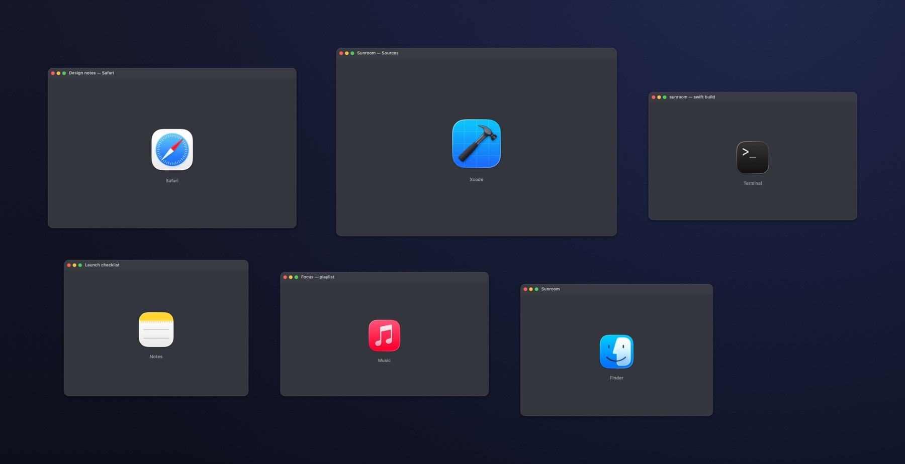

<p align="center">
  
</p>

<h1 align="center">Sunroom</h1>

<p align="center"><strong>Your windows, on one infinite canvas.</strong></p>
<p align="center">Put every window on a single plane. Zoom out to see everything. Click a window to go in.<br>
Press <code>⌃⌥Space</code> from any app.</p>

<p align="center">
  <a href="#requirements"></a>
  <a href="https://swift.org"></a>
  <a href="LICENSE"></a>
</p>



*An illustration of canvas mode: every window keeps its app alive on one plane. Real screenshots of live canvas mode
need Accessibility granted, so this one is drawn by the app's own renderer.*

> **Project status:** 0.2, early but usable. Canvas mode, multi-display-aware placement, the boards surface, persistence
> and the window pipeline are implemented, with 324 headless tests. Everything is local; there is no account, no sync
> service and no network code.

## Why

Your Mac still thinks in desks. Each window belongs to exactly one Space, Spaces run left to right, and moving between
them feels like opening drawers. But the work is the *relationship* between windows: the browser next to the design file,
the terminal behind both, the note with the three things you keep forgetting.

Sunroom makes the desktop a plane. Press `⌃⌥Space` and every window pulls back onto one surface, keeping its real
position and its real content. Two fingers pan, pinch zooms, a click dives into a window and fills the screen.
`⌃⌥Space` brings the plane back. Nothing is hidden behind a desktop you have to remember.

The concept is not ours: **[Pane](https://trypane.app)** set the bar for this interaction on macOS, and
**[phantomat](https://github.com/kaolti/phantomat)** proved it on Hyprland. Sunroom is an independent implementation,
MIT licensed, built on public macOS APIs plus the one private symbol every window manager needs. More on that below.

## Features

### Canvas mode

- **The whole desktop on one plane.** `⌃⌥Space` gathers every window on the current display, keeps its arrangement,
  and zooms out until all of it fits.
- **Trackpad-native.** Two fingers pan, pinch zooms around the pointer, double-tap fits everything. No modifiers.
- **Click to go in.** A window animates to fill the screen and its app comes forward; `⌃⌥Space` returns to the plane.
- **Drag to arrange.** Drag a window anywhere on the plane; drop it on another window to stack, or on a screen edge to
  tile left, right, top, bottom or a quarter.
- **Keyboard too.** Arrows pick the nearest window, `↩` goes in, `Tab` cycles, `F` fits, `Esc` restores the desktop
  exactly as it was.
- **One plane per display.** Canvas mode only gathers the display you invoke it on; other screens keep working. Window
  positions are remembered per app and title, so the plane comes back the way you left it.

### Boards

Sunroom also ships a plain infinite canvas for notes, images and links — the thinking surface that started the project.
It lives beside canvas mode and shares the same engine.

- **One endless plane** for notes, text cards, images, links and frames, with 2%–1200% anchor-preserving zoom.
- **Live window cards** captured with ScreenCaptureKit, for pinning a window's contents next to your notes.
- **Snapping that behaves**, alignment, distribution, four arrangement modes, frames that adopt what you drag over them.
- **⌘K command palette** with 47 wired commands and fuzzy object search; type anywhere to find things.
- **Local-first files** in Application Support: readable JSON, atomic writes, five rotating backups, quarantine for
  corrupt files.

### Craft

- **Native through and through.** SwiftUI for structure, AppKit where it matters, Liquid Glass chrome on macOS 26 with a
  material fallback on 14 and 15.
- **No Screen Recording.** Canvas mode moves the windows you already have; it never captures them. Window cards on a
  board are the only thing that asks for screen access, and they are optional.
- **No third-party dependencies.** No analytics, no crash SDK, no auto-updater phoning home.
- **Snapshot undo, colour tokens, versioned documents** that migrate instead of breaking.

## What macOS allows, and what it does not

This matters, because every canvas window manager on macOS collides with it.

The clean way to put another app's window on a plane is a compositor transform: scale and translate the window without
touching its layout. macOS has that API (`CGSSetWindowTransform` in SkyLight), and it works on your own windows — but
on macOS 26 the window server silently discards transform requests for windows the calling process does not own. The
check is server-side, keyed to the mach port, and bypassing it requires Apple's private `universal-owner` entitlement
or disabling SIP. We verified this the hard way: transforms apply and read back for our own windows, and no-op for
everyone else's.

So canvas mode does what is actually possible with Accessibility: it moves and resizes real windows. Two consequences,
stated plainly:

1. **Content reflows when you zoom out.** Apps lay themselves out for their new size, the way they would if you resized
   them by hand. It is not a bitmap zoom of a frozen snapshot.
2. **Zoom stops at about a third.** Apps enforce minimum window sizes, so the plane clamps rather than fighting them.

In exchange you get real, live, interactive windows with no screen capture, no permission beyond Accessibility, and no
battery cost. If Apple ever opens up compositor transforms, the plane can switch to them without changing the model.

## Keyboard shortcuts

| Shortcut | Action |
| --- | --- |
| `⌃⌥Space` | Put the windows on a canvas / return to the canvas / leave |
| `Esc` | Leave canvas mode and restore every window |
| `F` | Fit all windows |
| `↑ ↓ ← →` | Select the nearest window |
| `↩` | Go into the selected window |
| `Tab` / `⇧Tab` | Cycle windows |
| Two fingers | Pan the plane |
| Pinch | Zoom around the pointer |
| Double-tap | Fit everything |
| Drag a window | Move it on the plane |
| Drop on an edge | Tile to that half or quarter |
| Drop on a window | Stack it on top |
| `⌘K` | Command palette (boards) |
| `⌥Space` | Summon the boards window |
| `⇧⌘W` | Windows on this Mac |
| `⌃⌥C` | Capture the desktop as board cards |

Board editing has its own full reference in [docs/KEYBOARD.md](docs/KEYBOARD.md).

## Install

### Requirements

- macOS 14 Sonoma or later (Apple silicon or Intel)
- Xcode 16 or later, or the Swift 6 toolchain with the macOS SDK
- No package dependencies, no CocoaPods, no Homebrew formulae

### Build from source

```sh
git clone https://github.com/shashvat1965/sunroom.git
cd sunroom
make app      # builds Sunroom.app; the script prints the path
make run      # builds and opens it
```

Drag the built `Sunroom.app` into `/Applications` if you want it to stay. Release builds are ad-hoc signed for now,
not notarised, so if you download a build from GitHub rather than compiling it, right-click the app and choose **Open**
the first time.

### Permissions, and why they are needed

Sunroom asks for two macOS permissions, each only when you first use the feature that needs it:

- **Accessibility** lets Sunroom read window positions and titles so canvas mode can move and resize real windows. It is
  required for `⌃⌥Space` to work. The boards surface works without it.
- **Screen Recording** is only used by board window cards, which capture the pixels of the specific windows you put on a
  board. Canvas mode never asks for it. Captures stay in memory, are never written to disk, and stop when you pause
  capture or quit the app.

Grant them in **System Settings → Privacy & Security → Accessibility** and **Screen Recording**. macOS usually asks you
to relaunch the app after a change. Sunroom does not request Input Monitoring, Full Disk Access or Automation, and it
does not use accessibility control over its own interface. If you would rather not grant either permission, use Sunroom
as a notes-and-images canvas; nothing else changes.

## Screenshots

Boards, the notes surface that shares Sunroom's engine:


*The main window. Everything floats over the canvas: the sidebar, the tool bar, the minimap. Nothing is a hard edge.*


*Dark mode. Window cards mirror the real window; the note colours become tinted glass instead of solid paper.*


*⌘K searches commands and objects with the same fuzzy matcher. Titles rank above body text.*


*The inspector is contextual: position, size, colour, corner radius and per-kind actions for the selection.*


*Every manageable window on the Mac, grouped by app, with a one-click Add and a Capture-desktop shortcut.*


*Double-click to edit in place. The card becomes the editor; ⌘Z treats the whole edit as one step.*


*Start typing anywhere to search. Everything that does not match recedes, and Return flies to the best match.*

## Architecture

```
Package.swift
├── Sources/
│   ├── SunroomCore/     pure model: geometry, documents, transforms, snapping,
│   │                    the desktop-plane layout engine, search, undo, persistence
│   ├── SunroomKit/      platform services: Accessibility window control and
│   │                    arrangement, ScreenCaptureKit capture, hot keys, settings,
│   │                    the canvas renderer and design tokens
│   ├── Sunroom/         app shell, canvas-mode controller and overlay windows,
│   │                    boards UI, Liquid Glass chrome
│   └── SunroomRender/   headless PNG renderer for docs and visual review
├── Tests/
│   ├── SunroomCoreTests/    324 assertions, no window server required
│   └── SunroomKitTests/     desktop mapping, coordinate conversion, settings
├── Scripts/             build-app.sh, make-icon.swift, packaging
└── docs/                architecture, keyboard reference, roadmap, quality log
```

`SunroomCore` is deliberately platform-free: it may import Foundation and CoreGraphics, and it must never import
AppKit, SwiftUI, ScreenCaptureKit or ApplicationServices. That rule is what makes the interesting parts — transform
math, snap solving, layout, undo, persistence migration — testable on any Mac without a window server, a display or a
TCC prompt. `SunroomKit` depends on Core and wraps the messy system APIs. The app target depends on both and contains
no business logic that cannot be moved down a layer. CI enforces the import rule with a grep, but the stronger
enforcement is review: if a view needs a computation, the computation goes in Core.

Dependencies point one way, `Sunroom → SunroomKit → SunroomCore`. Core knows how to store a window card; only
SunroomKit talks to the window server.

Read [docs/ARCHITECTURE.md](docs/ARCHITECTURE.md) for the coordinate spaces, transform invariants, spatial index sizing,
level-of-detail thresholds, capture cadence, Accessibility batching, and the on-disk format.
[docs/QA.md](docs/QA.md) records what has actually been verified, and what has not.

## Roadmap

- **0.2 — Canvas mode.** The desktop as one plane: enter/exit with `⌃⌥Space`, pan and zoom, click to dive in, drag to
  stack and tile, per-display canvases, remembered positions. *(done)*
- **0.1 — Foundations.** Canvas model, transform, snapping, arrangements, frame grouping, snapshot undo, JSON
  persistence with backups and quarantine, fuzzy search, sample canvas, headless test target, ScreenCaptureKit card
  pipeline, Accessibility layout push, permission onboarding, Liquid Glass shell. *(done)*
- **0.2 — Windows, deeper.** Per-display layout, continuous follow mode where it is safe, pausable capture shortcut,
  window-picker drag source. *(next)*
- **0.3 — Multi-display.** Map canvas regions to physical displays, display-aware fit, per-display window sets.
- **0.4 — Daily driver.** Custom shortcuts, PNG/PDF export, richer text, layout profiles, performance budget at 25k
  nodes on an M1.
- **Later, if it earns its place.** Board linking, a read-only presentation mode, and a small extension surface.
  Cloud sync and accounts are explicitly out of scope.

The honest version, including what is deliberately not planned, is in [docs/ROADMAP.md](docs/ROADMAP.md).

## Contributing

Contributions are welcome, especially bug reports with a reproduction and pull requests that keep Core pure. Start
with [CONTRIBUTING.md](CONTRIBUTING.md); the short version is `swift build`, `swift test`, no third-party packages, and
one logical change per pull request. By participating you agree to the [Code of Conduct](CODE_OF_CONDUCT.md). Security
issues should follow [SECURITY.md](SECURITY.md) instead of the public issue tracker.

## Credits

Sunroom is an independent implementation. It is not a fork, and no code has been copied from the projects below. Their
ideas shaped the design, and their licences are recorded here with gratitude:

- **[phantomat](https://github.com/kaolti/phantomat)** (BSD-3-Clause) — a zoomable, infinite-canvas window manager
  for Hyprland. The clearest existing argument that windows belong on a plane rather than in a switcher.
- **[yabai](https://github.com/koekeishiya/yabai)** (MIT) — a macOS tiling window manager and the reference for how
  much of the Accessibility API is held together with patience and retries.
- **[AeroSpace](https://github.com/nikitabobko/AeroSpace)** (MIT) — a keyboard-first tiling window manager for macOS,
  and a good study in making window control feel instant.
- **Muse** and **Kosmik** — canvas apps whose feel informed the interaction model. Both are proprietary; they are
  credited as inspiration only, with no code or assets used.
- The **Contributor Covenant** (CC BY 4.0) for the code of conduct text.

If you believe something here is attributed incorrectly, please open an issue; attribution fixes are taken seriously.

## License

Sunroom is released under the [MIT License](LICENSE). Copyright © 2026 Shashvat.
